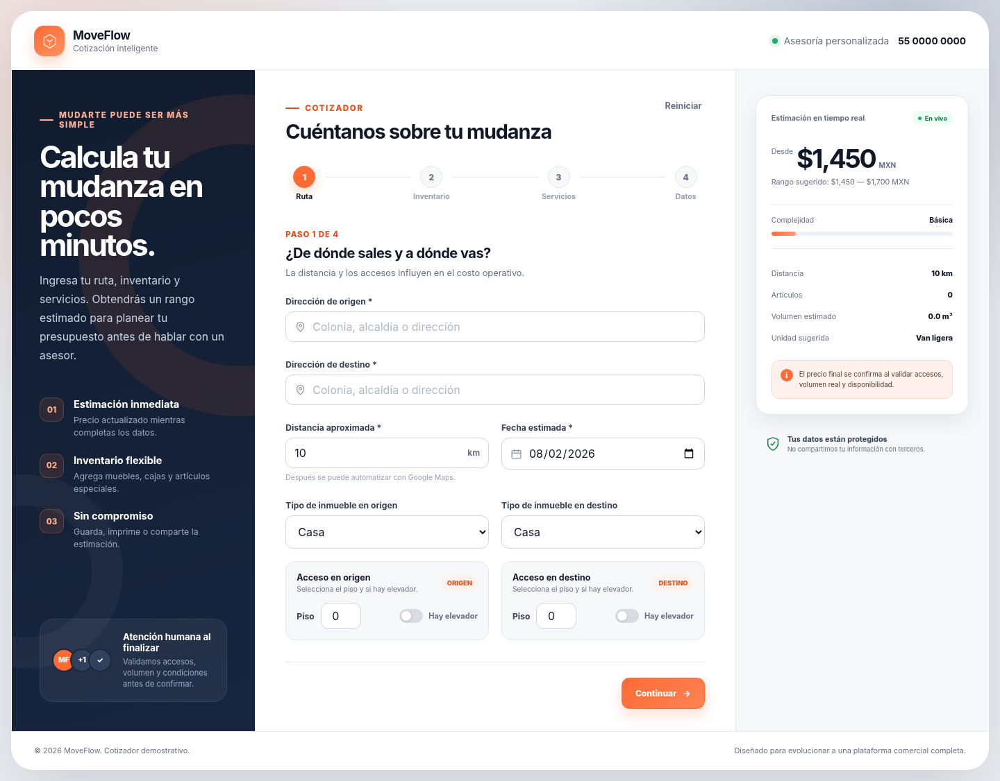
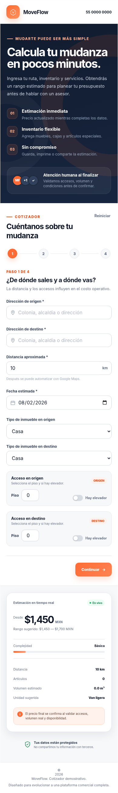

# MoveFlow — Cotizador profesional de mudanzas

Primera versión funcional de una web app para generar estimaciones preliminares de servicios de mudanza.

## Funciones incluidas

- Formulario dividido en cuatro pasos.
- Captura de origen, destino, distancia, fecha y accesos.
- Inventario editable por tipo de mueble o artículo.
- Presets para mini mudanza, 1 recámara, 2 recámaras y casa familiar.
- Servicios adicionales: empaque, armado, frágiles, cobertura, acarreo y prioridad.
- Cálculo dinámico del rango estimado.
- Recomendación automática de tipo de unidad.
- Indicador de complejidad.
- Guardado automático del avance en el navegador.
- Validaciones básicas.
- Resumen final, copia al portapapeles e impresión/guardado como PDF.
- Diseño responsive para computadora, tableta y celular.

## Cómo abrirlo en Visual Studio Code

1. Descomprime la carpeta.
2. Ábrela desde Visual Studio Code: `Archivo > Abrir carpeta`.
3. Abre la terminal integrada.
4. Ejecuta:

```bash
npm install
npm run dev
```

5. Abre la dirección que muestre Vite, normalmente:

```text
http://localhost:5173
```

## Alternativa sin Node.js

También puedes instalar la extensión **Live Server** en Visual Studio Code y abrir `index.html` con **Open with Live Server**.

> Para desarrollo real se recomienda usar Vite mediante `npm run dev`.

## Dónde modificar los precios

La lógica se encuentra en:

```text
src/main.js
```

La constante `PRICING`, ubicada al inicio del archivo, concentra las tarifas para que puedas cambiar:

- costo base;
- tarifa por kilómetro;
- costo por volumen;
- maniobras por artículo;
- recargos por piso;
- precios de servicios adicionales;
- porcentajes de cobertura, fin de semana o prioridad.

Los artículos disponibles están al inicio del archivo, en la constante `INVENTORY`. Los paquetes rápidos se encuentran en `PRESETS`.

## Vista previa

### Escritorio



### Celular



### Cotización final


## Dónde modificar colores y diseño

Los colores principales están al inicio de:

```text
src/styles.css
```

Variables destacadas:

```css
--brand
--brand-dark
--navy
--surface
--ink
```

## Siguientes integraciones recomendadas

1. Google Maps o Mapbox para calcular distancia y tiempo automáticamente.
2. Panel administrativo para editar tarifas sin tocar código.
3. Base de datos para guardar prospectos y cotizaciones.
4. Envío de cotización por correo y WhatsApp.
5. Generación de folio y PDF con identidad corporativa.
6. Carga de fotografías o video del inventario.
7. Inicio de sesión para asesores y seguimiento por estatus.
8. Pagos o anticipo en línea.

## Aviso

La fórmula incluida es demostrativa y debe ajustarse a las tarifas reales, zonas de cobertura, capacidad de unidades, seguros y políticas comerciales de la empresa.
