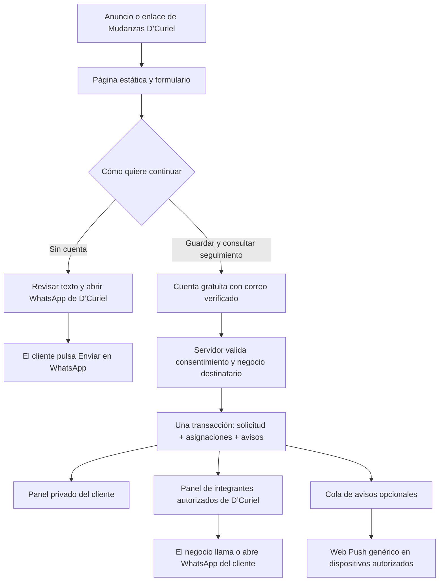

# Arquitectura de negocios, solicitudes y costos

Decisión de arquitectura: **una solicitud se dirige a un negocio concreto y a su equipo autorizado, nunca a todos los mudanceros registrados**. El piloto opera con Mudanzas D’Curiel; ampliar el catálogo no debe multiplicar los destinatarios de las solicitudes existentes.

Fecha de revisión: **30 de octubre de 2026**. Los precios son referencias públicas consultadas en esa fecha, no una cotización ni un compromiso del proveedor. Los importes en USD deben presupuestarse aparte de los cobros en MXN, impuestos, tipo de cambio y servicios externos.

## Qué está preparado y qué falta activar

| Área | Estado y límite de esta entrega |
| --- | --- |
| Página y formulario | Publicados como sitio estático. WhatsApp abre la línea de D’Curiel atendida por Tere; el cliente confirma el envío. |
| Cuentas | Código de acceso individual, recuperación y segundo factor preparado. No se han creado cuentas reales para Tere ni Marco. |
| Panel | Solicitudes y notificaciones privadas para el cliente y los integrantes autorizados. La lista se consulta por páginas y el detalle se obtiene al abrir una solicitud. Requiere la conexión de producción. |
| Separación de negocios | Migración `202610300004_business_routing.sql`: negocios, integrantes y atribución de la solicitud a un negocio. Debe aplicarse después de las migraciones 001–003. |
| Avisos al teléfono | Web Push preparado y desactivado. Necesita servidor, secretos, disparador y permiso por dispositivo. No es WhatsApp automático. |
| Pagos | Sin procesador conectado, suscripciones cobradas ni renovación automática. El acceso actual corresponde al piloto. |
| Capacidad masiva | No certificada: falta una prueba de carga representativa y operación observada. No hay una garantía de millones de usuarios simultáneos. |

Supabase, el correo transaccional y las cuentas de producción están pendientes. Un archivo SQL o una pantalla de inicio de sesión no crea por sí mismo el servicio remoto. Los pasos de activación están en [backend](backend.md), [seguridad y cuentas](seguridad-y-cuentas.md) y [lanzamiento](lanzamiento.md).

## Dos caminos claros para el cliente

La rama de cuenta y servidor estará disponible al activar la nube. **El camino de WhatsApp no guarda una solicitud en el panel del negocio.** La web no puede comprobar que el cliente pulsó Enviar, que el mensaje se entregó o que el negocio lo leyó. Tampoco importa automáticamente conversaciones de WhatsApp. Esta diferencia debe mantenerse visible en la interfaz.

La solicitud guardada pertenece al cliente que la envía y al negocio elegido. Abrir WhatsApp desde el panel no cambia su estado ni acredita una contratación. El precio, disponibilidad y condiciones se acuerdan con una persona.

Más adelante podrá añadirse recepción de invitados sin cuenta, pero requiere otro punto de entrada en el servidor, controles contra abuso y un mecanismo seguro para reclamar el seguimiento. **No está implementada en esta fase**; no usar `anon` con permisos de escritura amplios como atajo.

## Modelo que permite incorporar más negocios

| Entidad | Propósito |
| --- | --- |
| Persona y perfil | Identidad individual, rol, contacto, segundo factor y autorización operativa. Tere y Marco tienen identidades distintas. |
| `businesses` | Identidad comercial y destino de una solicitud, por ejemplo el negocio `d-curiel`. |
| `business_memberships` | Relación entre una persona y un negocio. Tener un nombre comercial parecido no concede pertenencia. |
| `move_requests` | Una copia del inventario, ruta, consentimiento y seguimiento; incluye el negocio destinatario. |
| `request_recipients` | Integrantes a quienes se asignó esa solicitud. Se revalida que todavía puedan consultarla. |
| `notifications` | Aviso privado, breve y sin repetir los datos del cliente. Leído/no leído pertenece a cada persona. |
| `private.push_outbox` | Trabajo pendiente de entrega con reintentos y deduplicación. El navegador no administra esta cola. |
| Suscripción y derechos comerciales | Futura entidad por negocio para plan, asientos, cuotas y vigencia de cobro. No está sustituida por el nombre del plan mostrado en el navegador. |

La referencia repetida del mismo cliente con los mismos datos y destinatario debe recuperar la misma solicitud. Cambiar el negocio o el contenido exige otra referencia, no un reenvío ambiguo. Guardar la solicitud y generar sus asignaciones y avisos en una sola transacción evita confirmar algo que ningún negocio puede recibir.

El piloto conserva la compatibilidad del envío familiar hacia D’Curiel. La difusión general de la red permanece cerrada: habilitar un indicador no debe asignar contactos a todos los proveedores. Una futura comparación de empresas necesitará selección explícita, consentimiento y un máximo pequeño de negocios destinatarios por solicitud, con atribución independiente.

## Cómo se mantiene bajo el consumo

1. **Servir el sitio desde archivos estáticos.** El catálogo y el formulario no requieren una consulta por cada campo o mueble. Evitar servidor por renderizado cuando no aporta una función necesaria.
2. **No exigir registro para iniciar una conversación.** La cuenta aporta seguimiento; no se crea automáticamente por visitar el anuncio. El cliente decide si desea guardar su solicitud en la nube.
3. **Una copia de la ficha.** Guardar identificadores en asignaciones y avisos; no duplicar inventarios completos por integrante ni por dispositivo.
4. **Destinatarios acotados.** La base limita el equipo de recepción a diez integrantes por negocio. D’Curiel empieza con dos. Un millón de negocios registrados no implica un millón de notificaciones por mudanza.
5. **Lecturas pequeñas.** Listas de veinte elementos con cursor estable y detalle bajo demanda; evitar descargar todas las solicitudes para filtrarlas en JavaScript. Las consultas siguen sujetas a permisos del servidor.
6. **Avisos por eventos.** No consultar la bandeja cada segundo ni mantener una conexión Realtime por visitante. El panel puede actualizarse por acción del usuario; Web Push es optativo y requiere la configuración indicada en su guía.
7. **Cola con límites.** Reutilizar la cola de PostgreSQL del piloto. Aplicar lotes, límites de concurrencia, reintentos finitos y tiempos máximos. Una falla externa no debe provocar un ciclo infinito de envíos.
8. **Datos con ciclo de vida.** Definir y ejecutar conservación de solicitudes, auditoría y trabajos terminados. Las copias de seguridad no justifican conservar cada contacto indefinidamente. No incorporar fotos o videos hasta tener cuotas, tratamiento y costos definidos.

Si `L` es el número de solicitudes guardadas, `S` los integrantes destinatarios por solicitud y `D` los dispositivos activados por integrante, las asignaciones y avisos internos crecen aproximadamente con `L × S`; los intentos de entrega al teléfono dependen además de `D` y de los reintentos. La implementación limita dispositivos por persona a cinco. Estos límites deben formar parte del producto y de su presupuesto.

Ejemplo de diseño, **no una prueba de capacidad**: 10,000 solicitudes para equipos de dos personas generan hasta 20,000 asignaciones y avisos internos. Con un dispositivo activo por persona serían hasta 20,000 entregas iniciales elegibles. Asignar cada solicitud a 10,000 empresas produciría 100 millones de asignaciones y expondría datos innecesariamente.

## Medir unidades distintas

| Unidad | Qué significa para MoveFlow |
| --- | --- |
| Visitas | Personas o robots que cargan la página, sin necesariamente iniciar sesión. |
| MAU de autenticación | Personas distintas que inician sesión o renuevan token durante el ciclo de cobro; no equivale al total histórico registrado. |
| Negocios | Empresas de mudanza. Una empresa puede tener varios integrantes con cuentas individuales. |
| Solicitudes | Fichas guardadas y asignadas. Un clic a WhatsApp no se cuenta como una solicitud recibida por el servidor. |
| Lecturas y transferencia | Páginas consultadas, detalles abiertos y bytes enviados desde la base. |
| Concurrencia | Personas y procesos realizando trabajo al mismo tiempo; puede saturar antes de alcanzar una cuota mensual. |

La definición de MAU corresponde al modelo de [facturación de autenticación de Supabase](https://supabase.com/docs/guides/platform/manage-your-usage/monthly-active-users). Evitar cuentas invitadas creadas automáticamente por visita: aumentarían la superficie de abuso y no resolverían el seguimiento del cliente.

## Referencias de precios para decidir, no para prometer gratuidad

| Servicio | Referencia consultada | Uso previsto |
| --- | --- | --- |
| Supabase Free | USD 0; 50,000 MAU, base de 500 MB y 5 GB de transferencia saliente incluidos. Puede pausarse tras una semana de inactividad. | Pruebas y piloto controlado, con respaldo propio. |
| Supabase Pro | Desde USD 25/mes; 100,000 MAU, 8 GB de disco y 250 GB de transferencia incluidos; recursos adicionales pueden cobrarse aparte. | Producción cuando continuidad, respaldos y carga lo justifiquen. |

El cómputo mínimo de un proyecto se cubre con los créditos indicados en Pro; aumentar el tamaño, agregar proyectos o consumir por encima de las cuotas cambia el precio. No interpretar las peticiones API sin límite numérico como cómputo o capacidad infinitos. [Precios de Supabase](https://supabase.com/pricing).

Ejemplo limitado a **autenticación**: con un millón de MAU en el esquema estándar consultado, el excedente sería `(1,000,000 − 100,000) × USD 0.00325 = USD 2,925/mes`. Faltarían el plan, cómputo, datos, correo y demás servicios. No es una estimación del costo total de MoveFlow ni de un millón de visitas anónimas. [Tarifa por MAU](https://supabase.com/docs/guides/platform/manage-your-usage/monthly-active-users).

| Alternativa de alojamiento propio | Referencia consultada |
| --- | --- |
| Cloudflare Pages estático | Peticiones a archivos estáticos gratis y sin límite de cantidad; las Functions consumen la cuota de Workers. [Condiciones de Pages](https://developers.cloudflare.com/pages/functions/pricing/). |
| Cloudflare Workers | Free: 100,000 peticiones/día y 10 ms de CPU por ejecución. Paid: mínimo USD 5/mes, 10 millones de peticiones y 30 millones de ms de CPU incluidos; excedentes por separado. [Tarifas de Workers](https://developers.cloudflare.com/workers/platform/pricing/). |
| Cloudflare Queues | Free: 10,000 operaciones/día y retención de 24 horas. Paid: un millón de operaciones/mes incluidas y USD 0.40 por millón adicional; aplican también el plan y otros consumos. [Tarifas de Queues](https://developers.cloudflare.com/queues/platform/pricing/). |

Queues suele consumir tres operaciones por entrega de un mensaje pequeño —escritura, lectura y eliminación—; los reintentos y mensajes mayores de 64 KB incrementan operaciones. No calcular un millón de mensajes como un millón de operaciones. La cola de Cloudflare es una opción futura si las mediciones justifican separar el procesamiento; **no está conectada ni sustituye la cola actual**. [Unidad de cobro de Queues](https://developers.cloudflare.com/queues/platform/pricing/).

El sitio publicado sigue alojado en **Sites**, no en una cuenta propia de Cloudflare Pages. Las referencias anteriores sirven para evaluar una migración; no describen la factura actual de Sites ni trasladan automáticamente sus límites al alojamiento presente.

### Correo, recuperación y control de gasto

El SMTP predeterminado de Supabase no está destinado a producción: limita el envío a direcciones autorizadas del equipo y la documentación indica dos mensajes por hora. Se requiere un proveedor SMTP propio para invitaciones y recuperación de clientes reales; también se revisan sus cuotas y entregabilidad. [Correo SMTP de Supabase](https://supabase.com/docs/guides/auth/auth-smtp).

Para el nivel gratuito, Supabase recomienda exportaciones regulares y copias fuera del servicio. El respaldo Git de MoveFlow contiene código, **no solicitudes ni cuentas de producción**. Pro ofrece respaldos diarios con retención de siete días; una recuperación más precisa exige otra configuración y costo. Ensayar restauración antes de depender de ella. [Respaldos de Supabase](https://supabase.com/docs/guides/platform/backups).

Conservar el límite de gasto disponible en Pro y revisar consumo y factura estimada. Ese control no cubre todo: cómputo, ciertos complementos y otros conceptos quedan excluidos, y no es un presupuesto personalizado con alertas para cada cantidad elegida. [Control de costos de Supabase](https://supabase.com/docs/guides/platform/cost-control).

Como política interna propuesta, revisar semanalmente el consumo del piloto y preparar alertas propias al 50%, 75% y 90% del presupuesto acordado. Esas alertas y los planes comerciales de pago **no están automatizados en esta entrega**. La base sí aplica un cupo operativo inicial de 300 solicitudes por mes UTC por negocio, ajustable por administración; no es un precio ni una suscripción. Nunca confiar solo en una alerta de facturación para frenar abuso.

## Suscripciones: cobrar al negocio, conservar accesos personales

El servicio comercial previsto es una suscripción de la empresa de mudanzas. Los clientes finales conservan acceso gratuito. Los futuros planes pueden diferenciar integrantes, zonas, herramientas y cantidad de oportunidades aceptadas; no deben vender acceso ilimitado a datos ni garantizar mudanzas contratadas.

Diseño de la integración posterior:

1. Crear planes y precios reales en servidor y en el procesador, asociados al negocio.
2. Abrir un checkout alojado; no recibir números de tarjeta en el formulario de mudanza.
3. Verificar la firma del webhook sobre su cuerpo original, deduplicar por identificador del evento y validar importe, moneda, negocio y suscripción esperados.
4. Actualizar los derechos del negocio desde eventos verificados y reconciliar eventos atrasados o fuera de orden. Volver del checkout no acredita el pago.
5. Hacer cumplir asientos, cuotas y vigencia en servidor, incluidas cancelaciones y periodo de gracia definido. Separar suspensión de operación de eliminación de datos.
6. Probar altas, cobros fallidos, reintentos, devolución, cancelación y recuperación antes de activar cargos.

Stripe México es una opción a evaluar: la tarifa consultada para tarjetas nacionales es 3.6% + MXN 3 por transacción exitosa; Billing publica 0.7% del volumen gestionado. Son conceptos distintos y pueden existir impuestos y otros cargos según el medio de pago y la cuenta. No hay una cuenta de Stripe conectada ni un precio de suscripción aprobado. [Procesamiento en México](https://stripe.com/en-mx/pricing), [Stripe Billing](https://stripe.com/mx/billing/pricing).

La viabilidad se mide por negocio: `ingreso neto de suscripción − pagos − infraestructura atribuible − soporte − adquisición − impuestos`. Una arquitectura económica ayuda, pero no demuestra demanda, rentabilidad ni ingresos futuros.

## Etapas y condiciones para ampliar

| Etapa | Alcance | Condición para avanzar |
| --- | --- | --- |
| D’Curiel | Una empresa, Tere y Marco con accesos propios, recepción selectiva. | Activar nube, SMTP y privacidad; comprobar flujo real y restauración con datos ficticios. |
| Primeros negocios | Incorporación administrada y una URL/destino inequívoco por negocio. | Pruebas de aislamiento entre empresas, baja de integrante, vencimiento y ausencia de destinatario; métricas de costo por solicitud. |
| Miles de cuentas | Mantener el monolito modular y la base compartida con permisos por negocio. | Prueba de carga representativa con picos, índices comprobados y consumo proyectado dentro del presupuesto. |
| Volumen elevado | Optimizar consultas, separar procesos y aumentar recursos donde la medición lo pida. | Plan de capacidad y recuperación, pruebas de carga nuevas y operación supervisada antes de anunciar límites comerciales. |

Antes de cada campaña medir latencia p50/p95, errores, tiempo de consultas, conexiones, CPU, crecimiento diario de tablas/índices, transferencia por ficha, MAU, cola pendiente y edad del trabajo más antiguo. Definir un objetivo de servicio y una tasa de llegada; probar al menos el pico esperado y un margen acordado. Las cuotas públicas de un proveedor no reemplazan esa prueba.

La validación actual del servidor limita el tamaño del contenido y las solicitudes por cuenta; no evita por sí sola ataques con muchas cuentas o llamadas rechazadas. Antes de recepción pública masiva, configurar controles de registro, CAPTCHA donde corresponda, límites de borde/IP, cuotas por negocio, observación y un procedimiento para cerrar recepción. No registrar cuerpos completos, teléfonos ni domicilios en métricas generales.

No dividir en microservicios ni una base por empresa solo por una cifra deseada de usuarios. Empezar con una base bien indexada, consultas pequeñas y permisos verificables; considerar particiones, réplicas o separación por regiones solo con evidencia y un plan de migración. La propiedad del código y las migraciones facilita cambiar de proveedor, pero deben respaldarse y trasladarse también datos, identidades, secretos y configuraciones.

## Pendientes inmediatos del propietario

- Crear o conectar el proyecto Supabase y aplicar las migraciones revisadas en orden.
- Proporcionar correos individuales de Tere y Marco; invitarlos, verificar correo, contraseña propia y segundo factor, y aprobar su acceso al negocio.
- Completar responsable, domicilio y correo del aviso de privacidad; revisar consentimiento y conservación.
- Configurar SMTP, redirecciones permitidas, respaldo externo y un presupuesto operativo.
- Probar: cliente guarda una solicitud, Tere y Marco la ven, otro negocio no la ve, una baja revoca acceso y los avisos no duplican la ficha.
- Mantener cobros, distribución general y avisos automáticos desactivados hasta completar su implementación y prueba real.

El objetivo inmediato es demostrar que D’Curiel recibe y atiende solicitudes de forma confiable. La ampliación comercial se hará sobre ese flujo, con cifras observadas y costos controlados.
